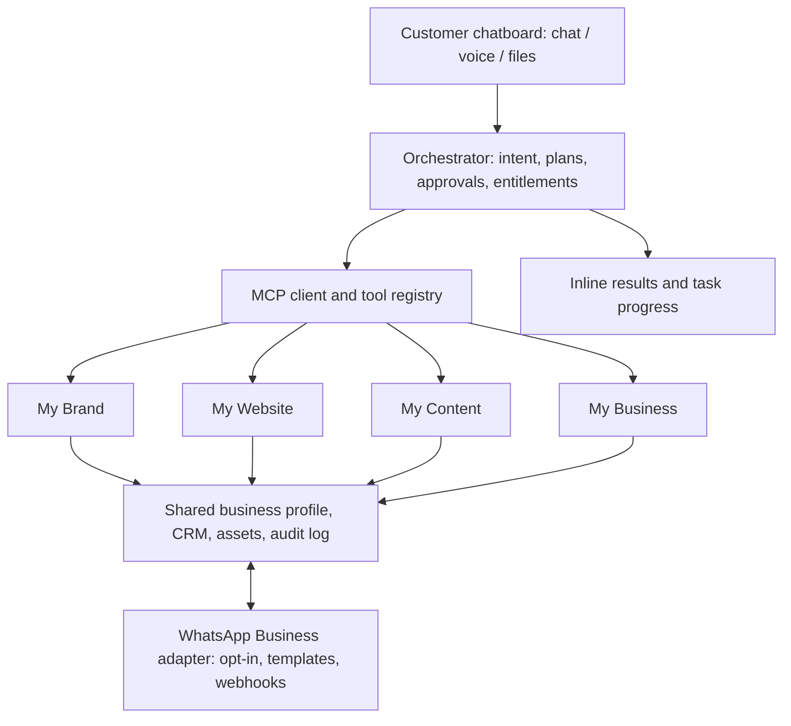

# CHATBLIZ OS — Agile Codex Build Specification

Status: implementation specification, not proof of completed features.
Source: existing Zuxuru/Bonga Bhengu codebase to be audited before extraction.
Priority: Chatbliz OS first; preserve Bonga Bhengu OS as a future private fashion-only workspace.

## Product invariant
Chatbliz is a **chatboard-first, MCP-powered business builder**, not four disconnected dashboards. The persistent chatboard accepts text, voice and attachments; produces previews, approvals, progress, errors and deliverables inline. An orchestrator uses an MCP client to discover authorized tools and execute real tasks. The four purchasable packages are **My Brand, My Website, My Content, My Business**. All four share one authorized WhatsApp Business connection and CRM.

## Architecture


## Four packages
- **My Brand:** business identity, logo, visual guide, brand assets, strategy and approved sharing.
- **My Website:** upgrade existing Zuxuru builder; visual editor, previews, templates, forms, domain/publishing and click-to-WhatsApp.
- **My Content:** media generation, digital studio, real capture device support when available, podcast, livestream, editing and approved distribution.
- **My Business:** leads, CRM, appointments, quotes, orders, sales pipeline, campaigns, analytics and customer consent.

## WhatsApp — one connection, four packages
Implement the official WhatsApp Business Platform where authorized and available. Shared onboarding, credential storage server-side, webhook verification, template approval status, consent/opt-out, delivery receipts, rate/error handling, inbox, CRM matching and audit history. Manual click-to-chat and share links must be explicitly labeled as manual, not API automation. Never scrape private contacts or send unsolicited promotions.

## AI employees
Jarvis orchestrates; Hunter discovers evidence-backed opportunities; Fishing proposes nurture campaigns; Closer assists quotations and conversations; Fixer diagnoses broken workflows; Brand, Builder and Studio agents generate artifacts. All actions are scoped to tenant, package entitlement, tool permissions and approval requirements. No invented agent execution.

## Chatboard UX — visual wireframe
```text
┌─────────────────────────────────────────────────────┐
│ CHATBLIZ OS                  Business ▾   Profile ▾ │
├───────────────┬─────────────────────────────────────┤
│ MY BRAND      │ Chatbliz AI                         │
│ MY WEBSITE    │ User: Build my salon brand + site   │
│ MY CONTENT    │                                     │
│ MY BUSINESS   │ [Plan] [Preview] [Approve] [Run]    │
│               │ Task 1/3: brand assets ready        │
│ WhatsApp ●    │ [Logo preview] [Website preview]    │
│ Tasks         │                                     │
│ Assets        │ Message / voice / attach       Send │
└───────────────┴─────────────────────────────────────┘
Mobile: package navigation collapses; chatboard remains primary.
```

## Agile delivery backlog
### Sprint 0 — audit and protect
- Inspect Zuxuru repositories and the current app; inventory components, dependencies, working and broken functionality.
- Preserve current main branch and production deployments; isolate Chatbliz development.
- Identify existing MCP servers, auth, database, builder, studio and WhatsApp code.
**Acceptance:** evidence-backed inventory, architecture decisions, migration risks.

### Sprint 1 — foundation
- Establish separate Chatbliz codebase/repository after confirming source and access.
- Working sign-in, business profile, four package entitlements and responsive chatboard shell.
- Persist conversations and tasks by tenant.
**Acceptance:** real sign-in and task persistence; no duplicate/overlapping UI.

### Sprint 2 — MCP execution
- MCP client/tool registry, per-tool schemas, permissions, approval gates, task queue, structured status/errors and audit events.
- Connect at least one real end-to-end tool in each package, not mock completions.
**Acceptance:** request → authorized tool → real result → saved artifact → displayed in chat.

### Sprint 3 — WhatsApp marketing
- One official onboarding flow, webhooks, CRM association, consent and approved templates.
- Four package entry points all reuse the same connection.
**Acceptance:** sandbox/test-business message round trip with audit and opt-out; manual mode separately verified.

### Sprint 4 — package workflows
- Branding assets → site preview → approved publishing → content campaign → lead/CRM follow-up.
- Package-specific tools, quotas, error recovery and approval UX.
**Acceptance:** repeatable multi-package workflow and integration tests.

### Sprint 5 — quality and release
- Security, accessibility, mobile UI, tenant isolation, rate limiting, integration tests, staging deployment and rollback plan.
**Acceptance:** documented test results and explicit approval before production deployment.

## Codex execution rules
1. Audit before editing or migrating; do not rebuild functional modules unnecessarily.
2. Do not overwrite bongabhenguos.online or convert it into a general business app.
3. Keep the customer chatboard as the primary interaction; editors are embedded/linked workspaces, not unrelated products.
4. No dead buttons, fake connectors, hardcoded success, invented lead data or unapproved sending.
5. Require explicit user approval for external publishing, marketing messages, spending or destructive actions.
6. Store credentials only in server-side secret management; isolate tenant data.
7. Implement in small PRs with tests and clear evidence; report what is actually operational.
8. The diagram and wireframe are design references, not screenshots of a working app.

## First Codex action
Audit the existing repositories for Zuxuru source and MCP integrations. Produce a migration map and first implementation PR for the chatboard foundation. Do not claim Chatbliz has been deployed.
